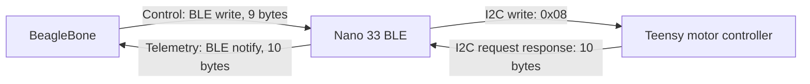

# NeuroExo motor communication

The BeagleBone sends controls to the Nano 33 BLE. The Nano forwards valid frames
unchanged over I2C to the Teensy at `0x08`, polls real motor telemetry every 40 ms,
and publishes valid responses back to the BeagleBone.



## Two Bluetooth channels

These are two directional GATT characteristics on **one BLE connection**.
Directions below are from the BeagleBone's perspective. There is no RFCOMM
channel number, simulated-position characteristic, or request/reply pairing.

| Purpose | UUID | Nano property | Direction |
| --- | --- | --- | --- |
| Service | `b7e20000-6a2b-4f10-9c31-8b674045a901` | — | — |
| Command / TX | `b7e20001-6a2b-4f10-9c31-8b674045a901` | Write | BeagleBone → Nano → Teensy |
| Telemetry / RX | `b7e20002-6a2b-4f10-9c31-8b674045a901` | Notify | Teensy → Nano → BeagleBone |

The existing command and notification UUIDs are retained, with new frame
contents. Flash the updated Nano sketch before using these clients. BLE writes
use an ATT response; that response confirms delivery to the Nano, **not** motor
acceptance by the Teensy. Telemetry arrives independently, even when the
BeagleBone sends no commands. This protocol has no sequence number, command
acknowledgment, device timestamp, calibration command, or trial identifier.

## Binary frames

`STX | TYPE | LENGTH | PAYLOAD | CRC8 | ETX`

- STX `02`, ETX `03`.
- CRC polynomial `07`, initial value `00`, no bit reflection, final XOR `00`.
- CRC covers TYPE, LENGTH, and every payload byte; markers are excluded.
- Signed 16-bit values use big-endian two's complement, in whole degrees or mA.
- Exactly one frame per BLE write/notification or I2C transaction.
- Invalid lengths, markers, CRCs, message types, modes, and speeds are rejected.

| Control byte | Meaning |
| --- | --- |
| 0–2 | `02 10 04` |
| 3 | Mode: `0` Resistive, `1` Assistive, `2` Neutral |
| 4 | Speed: `0` Slow, `1` Medium, `2` High |
| 5–6 | `targetAngleDeg`, signed int16 |
| 7–8 | CRC8, `03` |

Assistive, High, −123°:

```text
02 10 04 01 02 FF 85 94 03
```

| Telemetry byte | Meaning |
| --- | --- |
| 0–2 | `02 11 05` |
| 3–4 | `currentAngleDeg`, signed int16 |
| 5–6 | `currentMilliAmps`, signed int16 |
| 7 | Status bits |
| 8–9 | CRC8, `03` |

45°, 1200 mA, motion active:

```text
02 11 05 00 2D 04 B0 01 52 03
```

**CRC correction:** the earlier README showed `AA` and `14` for these examples.
The supplied `commProtocol.cpp` produces `94` and `52`; the clients and Nano use
those results. The CRC check value for ASCII `123456789` is `F4`.

| Bit | Name | Meaning |
| --- | --- | --- |
| 0 | MotionActive | A trajectory is active |
| 1 | CommandTimeout | No valid control command within 250 ms |
| 2 | InvalidCommand | Most recent received I2C command was invalid |
| 3 | SafetyFault | Controller e-stop latched; commands ignored until the specified 250 ms command-free interval |

The Teensy owns motor control, measured current/angle, and the watchdog. Status
bits are relayed unchanged. Reserved bits remain visible in the raw status byte.
`CommandTimeout=1` is expected during receive-only monitoring without controls.

## Timing and failures

The control tools resend the requested command every 100 ms by default; allowed
intervals are 20–200 ms, below the Teensy's 250 ms timeout. There is no automatic
reconnect or replay following a transport failure. Linux/BLE scheduling is not a
real-time guarantee; a missed deadline can still trigger the Teensy watchdog.

The Nano never generates a heartbeat, retries a command, fabricates measurements,
or republishes a cached telemetry frame after an invalid I2C response. If BLE
control stops, the Teensy must disable motion after 250 ms. Its I2C callbacks
must only copy/transmit buffers; decoding and motor state changes belong in its
normal loop, as described in the supplied firmware specification.

Clients subscribe before sending and require valid telemetry before starting
control. Both continuously display angle, current, and every status flag.
Control runs stop sending on SafetyFault or InvalidCommand. They do not
automatically resume when a fault clears. A normal control exit attempts one
Neutral command; receive-only monitoring never sends commands. A reported
SafetyFault stops all command transmission so its command-free interval can run.

Corrupt notifications are discarded without refreshing feedback timestamps.
The latest valid sample replaces the previous one, preventing an unbounded
backlog. The CLI reports missing/stale telemetry after 500 ms by default;
`Hardware_Interface::latestMotorTelemetry()` uses 250 ms by default. Host receipt
time is not a Teensy measurement timestamp. This format cannot detect a Teensy
that keeps responding with an old but valid frame.

## Implementation

- [Nano bridge](../NeuroExoFirmware/src/nanoBridge.cpp)
- Shared C++ codec: [commProtocol.h](../NeuroExoFirmware/src/commProtocol.h),
  [commProtocol.cpp](../NeuroExoFirmware/src/commProtocol.cpp)
- [Python codec](neuroexo_protocol.py), [Python BLE client](neuroexo_motor.py)
- [C++ client](BleMotorClient.hpp), [BlueZ transport](BluezGatt.cpp)
- [Hardware interface](Hardware_Interface.hpp): `sendMotorControl`, `stopMotor`,
  `readMotorTelemetry`, `latestMotorTelemetry`, `lastArmPositionDegrees`

The supplied Teensy protocol is the compatibility reference. The Teensy
`NeuroExoFirmware/src/main.cpp` imported from `main` still accepts the legacy
three-byte `0x01` angle command and has no I2C telemetry response. It is not yet
compatible with the framed bridge. Use the separately supplied Teensy firmware
that implements the specified I2C protocol, watchdog, and safety flags.

For setup, commands, and checks, see [the reader procedure](BEAGLEBONE_READER_PROCEDURE.md).
